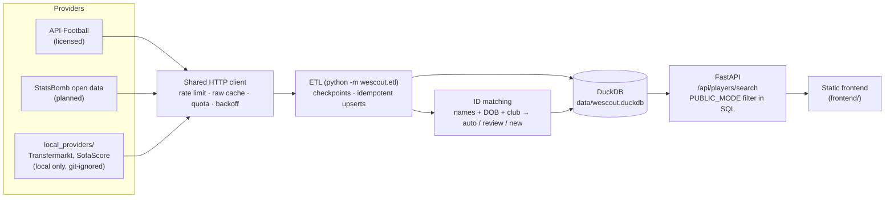

# WeScout

**Live demo:** _coming soon_ · 

> **Disclaimer:** This project is a personal, educational exercise built for learning purposes (web scraping, APIs, data handling, and basic frontend/backend integration). It is **not** a commercial product, and there is **no intent to commercialize, sell, or monetize** it in any way. It scrapes publicly viewable data from Transfermarkt and SofaScore for personal, non-commercial use only, and is not affiliated with, endorsed by, or sponsored by either site. Use of this code is subject to those sites' respective terms of service.

WeScout is a football scouting tool. A data pipeline pulls player and season statistics from a
licensed API into a local DuckDB database, matches the same player across sources, and serves
filtered searches (position, age, value, minutes) from a FastAPI backend in milliseconds. The
old version scraped live on every request and took minutes. Phase 2 adds per-90 analytics and
a model that predicts how a player's value will change over two years.

## Architecture



- **Providers** turn each source's payloads into typed records. They never touch the database.
- **The ETL** is the only code that calls providers. The API never does: every search is a
  single SQL query.
- **Facts are keyed by the provider's own IDs**, and one column links them to a canonical
  player. Re-matching a player never rewrites data.
  See [`docs/decisions.md`](docs/decisions.md) (ADR-003).

## Quick start

```bash
uv sync                                   # Python ≥ 3.12, pinned via uv.lock
cp .env.example .env                      # add API_FOOTBALL_KEY
uv run python -m wescout.etl --seasons 2023            # resumable; re-run daily on the free plan
uv run uvicorn wescout.api.main:app --port 5000        # API + frontend at http://localhost:5000
```

### ETL

```bash
uv run python -m wescout.etl --competitions 39,140 --seasons 2022,2023 --transfers
uv run python -m wescout.etl --max-requests 20     # cap the requests used by this run
uv run python -m wescout.etl --resolve-only        # re-run ID matching only
```

Default leagues: Premier League, La Liga, Serie A, Bundesliga, Ligue 1, Eredivisie, Primeira
Liga and Brasileirão. On API-Football's free plan the limits are:
- 100 requests per day;
- seasons 2022–2024 only;
- at most 3 pages per query.

So the ETL loads league by league and club by club, about 50 requests per league-season. When
the quota runs out it stops cleanly, and the next run continues from the last checkpoint. Each
run prints a JSON summary: records, runtime, requests used and quota left.

### API

| Route | Notes |
|---|---|
| `GET /api/players/search` | `min_age`, `max_age`, `min_value`, `max_value`, `position` (gk, cb, lb, …), `season`, `min_minutes`, `limit` |
| `GET /api/positions` | position codes used by the frontend |
| `GET /api/health` | status + whether public mode is on |

Interactive docs at `/docs`.

### Tests and checks

```bash
uv run pytest            # no network: a socket guard fails any test that tries
uv run ruff check . && uv run ruff format --check . && uv run mypy wescout
```

CI runs the same commands on every push and pull request (`.github/workflows/ci.yml`).

## Data sources and licensing

| Source | License | Used for | In public demo |
|---|---|---|---|
| [API-Football](https://www.api-football.com) | Licensed (API key) | players, season stats, clubs, transfers | yes, with attribution |
| [StatsBomb open data](https://github.com/statsbomb/open-data) | Open data licence | planned | yes, with attribution |
| Transfermarkt, SofaScore | Terms prohibit scraping | local experiments only | **never** |

- The scraper code isn't in this repository. It lives in a git-ignored `local_providers/`
  folder and only loads with `ENABLE_LOCAL_SCRAPERS=true`. It uses an honest User-Agent, waits
  at least 2 s between requests, runs nothing in parallel, and caches responses. When a site
  refuses (both currently do), the code stops; it never works around a block.
- `PUBLIC_MODE=true` is the default. It removes every scraped value, position and player from
  API responses, and is enforced in SQL.
- No scraped data is used to train or evaluate models.
- No data is committed: `data/`, `*.duckdb`, caches and `.env` are git-ignored.

## Measured results

Full method in [`docs/benchmarks.md`](docs/benchmarks.md).

| Metric | Before (Flask + live scraping) | After (FastAPI + DuckDB) |
|---|---|---|
| Search latency | ~3 min estimated (endpoint actually returned HTTP 500) | see benchmarks |
| Third-party requests per search | ~200–300 | 0 |
| ID matching (21 labelled pairs) | regex on page text | precision 1.00, recall 0.81 |

## Project structure

```
wescout/
  config.py            settings from env (.env)
  models.py            typed records shared by providers, DB and API
  providers/           Provider protocol, shared HTTP client, API-Football, registry
  db/                  migrations (SQL), connection + runner, upserts, integrity checks
  matching.py          name normalisation, scoring, manual overrides
  resolve.py           assigns canonical player IDs in the DB
  etl.py               CLI: python -m wescout.etl
  api/                 FastAPI app + search query
frontend/              static HTML/CSS/JS (served by the API)
scripts/               benchmark_search.py, eval_matching.py
eval/match_labels.csv  hand-labelled pairs for matching precision/recall
tests/                 pytest, recorded fixtures only
docs/                  benchmarks.md, decisions.md
```

## Roadmap

1. **Data foundation** (this phase): providers → DuckDB → ETL → API. ✅
2. **Analytics + ML:** per-90 stats, percentiles by position and league, role scores, similar
   players, and the two-year value-growth model. The model is evaluated on a time-based split
   against naive baselines.
3. **Product:** a clickable 4-2-3-1 pitch for picking positions and roles.
4. **Bonus:** natural-language search, where an LLM translates text into a structured query.
   The LLM never names players or invents stats.

## Limitations

- **Free-plan coverage.** Seasons are 2022–2024 only, and a full 8-league season needs about 4
  days of quota.
- **Coarse positions.** API-Football reports only GK/DF/MF/FW, so a search for `lb` falls back
  to all defenders when no detailed position is known.
- **No licensed market values yet.** In public mode the value filter has nothing to apply to,
  and the Phase 2 target is still open (ADR-006).
- **Some legacy stats are missing.** Pass completion and big chances created aren't available
  from API-Football at season level.
